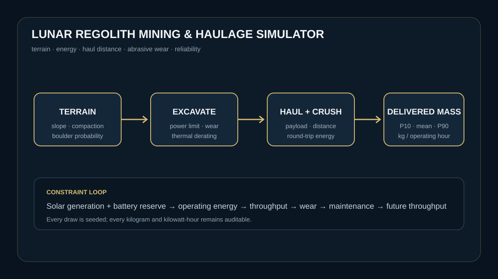

# Adaptive Lunar Regolith Mining & Additive Construction Systems Model

A reliability-constrained model of lunar surface excavation and feedstock
delivery. It connects terrain, digging energy, rover haul distance, solar power,
battery reserve, abrasive wear, maintenance, and boulder delays.

The extended model carries that material into binder-free construction. A
composition-aware controller compares adaptive laser vitrification, pulsed
electrical discharge, and microwave sintering, then chooses the process that
maximizes usable printed mass and quality per unit of energy at each site.
Mine-near-print energy, imported consumables, and local composition remain in
the ledger. Leave-one-site-out validation compares the adaptive selector with a
single process chosen from the other sites, so an efficiency claim has to
survive an unseen regolith composition.



```bash
python -m pip install -e .
python model.py
pytest -q
```

## The question

How much regolith can an autonomous mining system actually deliver to a
processing plant once terrain, energy, hauling, wear, dust, and downtime are
counted together?

The simulator advances hourly, conserves excavated mass, accounts for
excavation, crushing and round-trip hauling energy, and triggers maintenance as
abrasive wear accumulates. A seeded reliability ensemble reports the P10, mean,
and P90 delivered mass rather than presenting one optimistic point estimate.

## Outputs

- excavated and delivered regolith
- unhauled surface inventory
- generated, used and curtailed energy
- boulder-delay and maintenance hours
- final wear state
- delivered mass per operating hour
- uncertainty range across seeded mission draws
- selected binder-free fabrication process by local composition
- usable printed mass, process energy, imported consumables and quality score
- leave-one-site-out adaptive gain against a fixed-process baseline

## Evidence base

- NASA, *Lunar Surface Mining for Automated Acquisition and Beneficiation of
  Regolith*: https://ntrs.nasa.gov/citations/20100033139
- NASA, *State of the Art of Small Spacecraft Technology — Power*:
  https://www.nasa.gov/smallsat-institute/sst-soa/power-subsystems/
- NASA, *ISRU Gap Assessment Report*:
  https://ntrs.nasa.gov/citations/20210022137
- NASA, laser-vitreous regolith construction:
  https://www.nasa.gov/directorates/stmd/nasa-enables-construction-technology-for-moon-and-mars-exploration/
- NASA TechPort, pulsed-electrical-discharge additive manufacturing:
  https://techport.nasa.gov/projects/154545
- NASA, raw-regolith directed-energy deposition:
  https://ntrs.nasa.gov/citations/20250010749

## Limits

This is a low-order software research model, not flight software or mission
planning advice. Energy, terrain and wear parameters are explicit assumptions.
The model omits detailed granular mechanics, thermal-vacuum qualification,
communications delay, navigation errors and site-specific geology.
